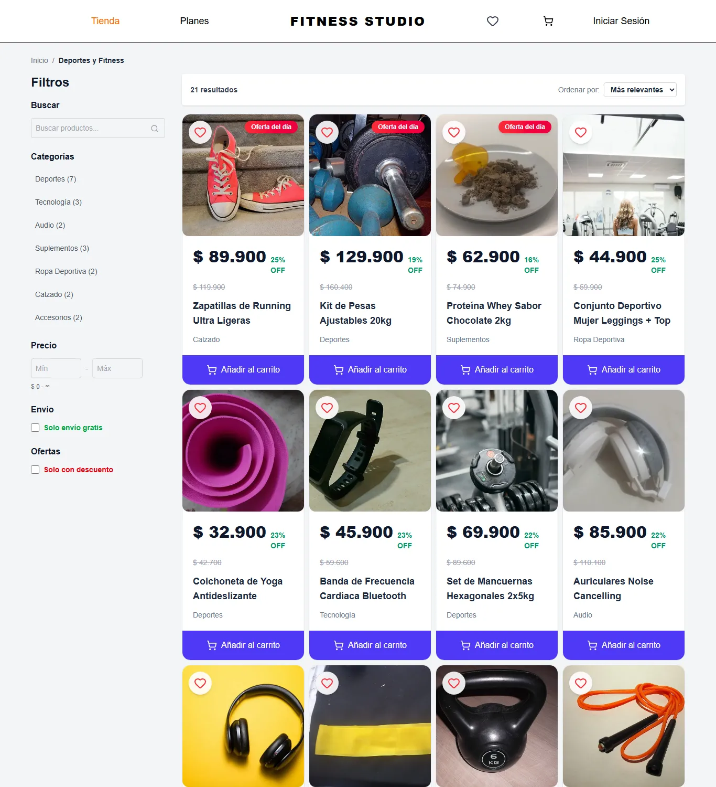
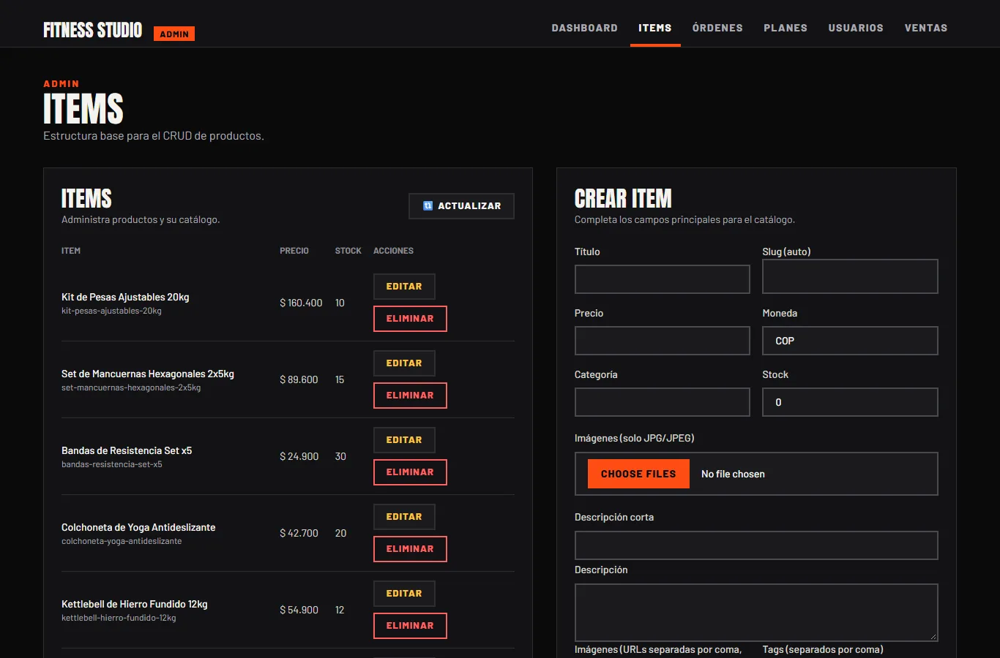
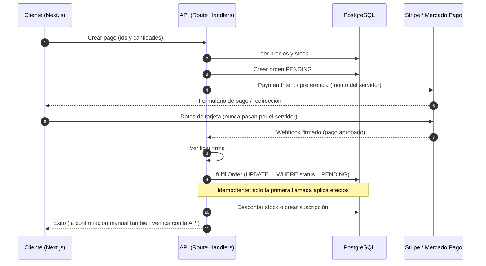

# Fitness Studio

[](https://github.com/JPS4L4/Tienda-Fitness-Pasarela-de-pagos-Carrito-y-Registro-Usuario/actions/workflows/ci.yml)

Tienda en línea de fitness: catálogo de equipamiento, planes de nutrición y entrenamiento por suscripción, carrito, registro de usuarios, pagos con **Stripe** y **Mercado Pago** y un panel de administración. Está pensada como proyecto completo de punta a punta, con foco en la corrección de los pagos y la seguridad.

> **Demo en vivo:** [tienda-fitness-pasarela-de-pagos-ca.vercel.app](https://tienda-fitness-pasarela-de-pagos-ca.vercel.app). Funciona en modo prueba: no se cobra nada.

## Capturas

| | |
|---|---|
|  |  |
| Inicio | Inicio en móvil |
|  |  |
| Catálogo | Detalle de producto |
|  |  |
| Plan de suscripción | Checkout con aviso de modo prueba |
|  | |
| Panel de administración | |

## Funcionalidades

- Catálogo con categorías, ofertas, favoritos, reseñas y carrito persistente.
- Planes de nutrición y entrenamiento por suscripción; el contenido es solo para suscriptores activos.
- Perfil fitness del usuario (requerido antes de comprar un plan) y avisos por correo al instructor.
- Registro con verificación de correo, recuperación de contraseña y login con Google/Facebook (opcional).
- Pagos con tarjeta (Stripe) y Mercado Pago, confirmados por webhook.
- Panel `/admin` para gestionar productos, planes, usuarios, órdenes y ventas.

## Stack

| Capa | Tecnología |
|---|---|
| Frontend | Next.js 16 (App Router), React 19, Tailwind CSS 4, Zustand, Framer Motion |
| Backend | Route Handlers de Next.js, NextAuth 4 (JWT), Resend |
| Datos | PostgreSQL con Prisma 6 |
| Pagos | Stripe (PaymentIntents), Mercado Pago (preferencias) |
| Calidad | TypeScript, ESLint, Vitest, GitHub Actions |

## Arquitectura: flujo de pago

El cliente nunca decide el precio: envía identificadores y cantidades, y el servidor calcula el monto desde la base de datos. La orden se completa una sola vez, aunque el webhook y la confirmación lleguen repetidos o en paralelo.



## Decisiones de seguridad

- **Precios en el servidor:** montos de Stripe y Mercado Pago calculados desde la base de datos; la confirmación verifica estado y monto contra la API de la pasarela.
- **Webhooks firmados:** Stripe con `constructEvent`; Mercado Pago con `x-signature`.
- **Idempotencia:** un `UPDATE` condicional sobre el estado `PENDING` hace de cerrojo, sin duplicar stock, suscripciones ni correos.
- **Admin fail-closed:** sin `ADMIN_EMAILS` nadie es administrador; se valida en middleware, layout y cada API.
- **Contenido de pago protegido**, sesiones con secreto obligatorio, errores genéricos hacia el cliente y límite de peticiones en el registro.

Detalle en [docs/security.md](docs/security.md) y [docs/payments.md](docs/payments.md).

## Cómo correrlo en local

Requisitos: Node.js 22 y Docker.

```bash
git clone https://github.com/JPS4L4/Tienda-Fitness-Pasarela-de-pagos-Carrito-y-Registro-Usuario.git
cd Tienda-Fitness-Pasarela-de-pagos-Carrito-y-Registro-Usuario
npm ci
cp .env.example .env          # y completa los valores (ver abajo)
docker compose up -d          # PostgreSQL en el puerto 55434
npx prisma migrate deploy     # aplica las migraciones
npm run db:seed               # datos y cuentas de demostración (borra datos; solo contra BD local)
npm run dev                   # http://localhost:3000
```

En `.env` son obligatorias `DATABASE_URL` (ya apunta al contenedor), `NEXTAUTH_SECRET` (`openssl rand -base64 32`), `NEXTAUTH_URL` y `NEXT_PUBLIC_APP_URL`. Pon `ADMIN_EMAILS="admin@fitness-studio.example"` para usar el panel con la cuenta demo. Las claves de Stripe (`sk_test_` / `pk_test_`) y de Mercado Pago son opcionales, pero sin ellas no se puede pagar. Todas las variables están comentadas en [.env.example](.env.example).

## Cuentas demo

El seed crea estas cuentas (contraseña de ambas: `Prueba123!`):

| Rol | Correo | Qué incluye |
|---|---|---|
| Administrador | `admin@fitness-studio.example` | Acceso a `/admin` (requiere estar en `ADMIN_EMAILS`) |
| Usuario | `demo@fitness-studio.example` | Perfil fitness completo, una suscripción activa y una orden completada |

## Tarjetas de prueba

El checkout muestra un aviso de **modo prueba**; no se realiza ningún cobro real.

- **Stripe:** `4242 4242 4242 4242`, cualquier fecha futura y cualquier CVC de 3 dígitos ([documentación](https://docs.stripe.com/testing)).
- **Mercado Pago (Colombia):** Mastercard `5254 1336 7440 3564` o Visa `4013 5406 8274 6260`, vencimiento `11/30`, CVV `123`, titular `APRO` y documento `123456789` ([documentación](https://www.mercadopago.com.co/developers/es/docs/checkout-pro/additional-content/your-integrations/test/cards)).

## Scripts

| Comando | Descripción |
|---|---|
| `npm run dev` | Servidor de desarrollo |
| `npm run build` / `npm start` | Build y servidor de producción |
| `npm run lint` | ESLint |
| `npm run typecheck` | Tipos de Next y `tsc --noEmit` |
| `npm test` / `npm run test:watch` | Pruebas con Vitest |
| `npm run db:up` | Levanta PostgreSQL con Docker |
| `npm run db:seed` | Siembra datos de demostración (con guardia contra BD remotas) |

## Pruebas e integración continua

Las pruebas de Vitest (`tests/`) cubren precios y descuentos, validaciones, acceso a planes, autorización de admin, cumplimiento idempotente de órdenes y webhooks. El workflow de [GitHub Actions](.github/workflows/ci.yml) ejecuta lint, typecheck, pruebas y build con un PostgreSQL efímero en cada push y pull request.

## Documentación adicional

- [Pagos y webhooks](docs/payments.md)
- [Seguridad](docs/security.md)
- [Login social (Google y Facebook)](docs/oauth.md)

## Créditos

Las imágenes provienen de Wikimedia Commons; autores y licencias en [public/images/CREDITS.md](public/images/CREDITS.md).
